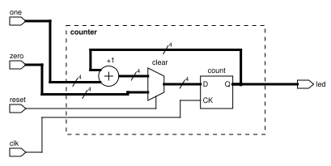
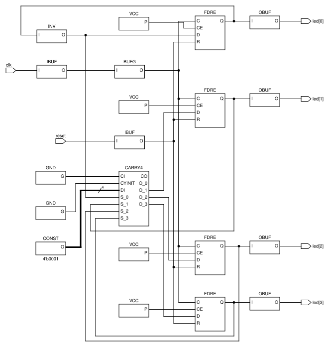

# Blockpic

[](https://github.com/filmil/blockpic/actions/workflows/main.yml)
[](https://github.com/filmil/blockpic/actions/workflows/samples.yml)
[](https://github.com/filmil/blockpic/actions/workflows/deploy_docs.yml)
[](https://github.com/filmil/blockpic/actions/workflows/release.yml)

blockpic lives at [github.com/filmil/blockpic](https://github.com/filmil/blockpic).
Issues and pull requests are welcome there.

Blockpic is a language for engineering block diagram typesetting, designed to produce diagrams with the aesthetics of Xilinx UG474 technical documentation.

## What it draws

A 4-bit LED counter, drawn by hand in
[`counter.blockpic`](samples/blockpic-in-docs/counter.blockpic). The slashes
mark bus widths:



The same counter as rules_openxc7 synthesizes it from
[`counter.v`](samples/blockpic-in-docs/counter.v): Yosys's netlist of
7-series primitives, drawn by `blockpic import` with no hand placement:



Both figures are built by Bazel from those sources, as in the
[sample paper](samples/blockpic-in-docs). Refresh the copies shown here
with `bazel run //:update_readme_images`; a test fails when they fall
behind.

## Usage

Blockpic provides a command-line interface for compiling and rendering diagrams.

### 1. Create a Diagram File
Create a file named `example.blockpic` with your logic definition:
```blockpic
diagram MyLogic {
    block AND1 { kind: "AND"; inputs: A, B [left]; outputs: O [right]; }
    block NOT1 { kind: "NOT"; inputs: I [left]; outputs: O [right]; }
    
    wire AND1.O -> NOT1.I { hint: "straight" }
}
```

### 2. Compile and Verify
Use the `compile` command to check for syntax errors:
```bash
bazel run //cmd/blockpic -- compile example.blockpic
```

### 3. Render the Diagram
Use the `render` command to generate an image (PNG is currently supported). Auto-layout will be applied if coordinates are not manually specified.
```bash
bazel run //cmd/blockpic -- render example.blockpic -format png -o output.png
```

### 4. Draw a Synthesized Netlist
The `import` command reads a Yosys JSON netlist and writes it as a
`.blockpic` file, which the steps above then render and refine. It reads,
for example, the netlist that `vivado_synthesis` in
[rules_openxc7](https://github.com/filmil/bazel_rules_openxc7) writes.
```bash
bazel run //cmd/blockpic -- import netlist.json -o design.blockpic
```
Without `-top`, the module that Yosys marked as the top is drawn.
Hidden cell names, such as `$abc$123$lut`, are replaced by the cell type and
a number, or by the name of the register bit that the cell holds.

### 5. Draw a Netlist with Bazel
In a Bazel build, `blockpic_netlist_diagram` in `//:defs.bzl` does steps 2
to 4 in one target. It takes any target whose only output is a Yosys JSON
netlist. A `vivado_synthesis` target of rules_openxc7 is one:
```python
load("@rules_openxc7//openxc7:defs.bzl", "vivado_project", "vivado_synthesis")
load("//:defs.bzl", "blockpic_netlist_diagram")

vivado_project(
    name = "counter",
    srcs = ["counter.v"],
    part = "xc7a200tfbg484-2",
    top_level = "counter",
)

vivado_synthesis(name = "counter_synth", project = ":counter")

blockpic_netlist_diagram(
    name = "counter_diagram",
    netlist = ":counter_synth",
    out = "counter.svg",
)
```
`bazel build //:counter_diagram` gives `counter.svg`. The imported
source is kept, as `counter_diagram.blockpic` from `//:counter_diagram_src`.
`tests/openxc7` is this example, with a test.

## Samples

`samples/` holds documents whose figures blockpic draws during the build.
`samples/blockpic-in-docs` is a three-page IEEE paper about a 4-bit LED
counter. One figure comes from a hand-written `.blockpic` file. The other
comes from the netlist that rules_openxc7 synthesizes from the Verilog.
```bash
bazel build //samples:pdfs
```
The `samples` workflow publishes the PDFs every Sunday to the rolling
[`samples`](https://github.com/filmil/blockpic/releases/tag/samples)
release, and the `release` workflow attaches them to every version's
release.

## Documentation

The project documentation is generated using Bazel and is available in PDF and HTML formats.

- **PDF**: `bazel build //ai:book_pdf`
- **HTML**: `bazel build //ai:html_chunked`

## Implementation

Implemented in Go using the `draw2d` library for vector graphics.
