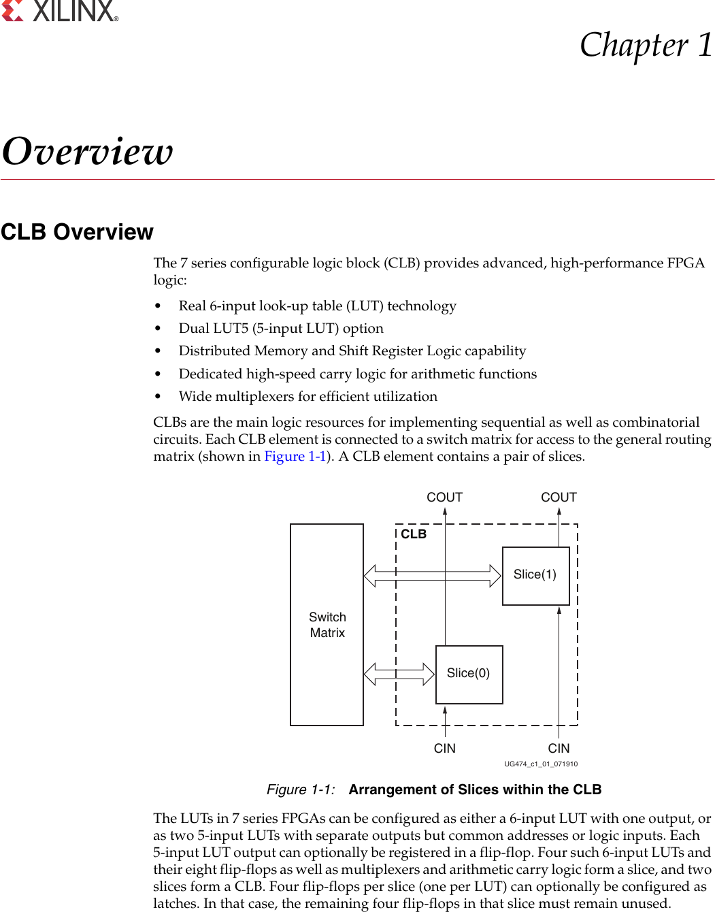

# Blockpic Datasheet: Implemented Features

This document provides a hierarchical overview of the features implemented in the Blockpic DSL and rendering engine.

## 1. Core Language (DSL)
*   **AST Structure**: Support for `Diagram`, `Block`, `Wire`, and `Layout` definitions.
*   **Lexer/Parser**: Recursive descent parser capable of reading `.blockpic` files.
    *   Block Attributes: `kind`, `inputs`, `outputs`, `params`, `size`.
    *   Wire Attributes: `source`, `destination`, `thickness`, `crossline`, `hint`.
    *   Layout Attributes: Explicit coordinate mapping (`at (x,y)`).

## 2. Rendering Engine
*   **Base Graphics**: Integration with `draw2d` for vector rendering.
*   **Aesthetics**: The default netlistsvg skin, `skins/skin_xilinx.svg`, follows
    the figures of AMD's UG474: Helvetica or Arial of regular weight, thin
    lines without arrowheads, pin names inside generic blocks and
    flip-flops (`D`, `CE`, `CK`, `Q`), small port flags, and plain
    multiplexer trapezoids. `skins/skin_with_arrows.svg`, the earlier bold
    monospace look with arrowheads, is chosen with the `skin` argument of
    `blockpic_diagram`.
*   **Shapes Library**:
    *   Basic Logic: `AND`, `OR`, `NOT` (IEEE standard geometry).
    *   Sequential: `DFF` (D-Flip-Flop with clock tick).
    *   Routing: `MUX` (Trapezoidal multiplexer).
    *   Fallback: Standard rectangular block rendering.
*   **Wire Routing**:
    *   Support for `thickness` styling.
    *   Bus-width marks: every wire wider than one bit is crossed by a
        short slash with its width beside it. The width is the wire's
        `crossline` when it has one, else its `thickness`. A wire with a
        `type: "name"` shows the type's name instead, and `blockpic import`
        takes it from the `wiretype` attribute that Yosys gives a wire
        declared with a SystemVerilog typedef.
    *   Orthogonal routing paths (`straight`, `L-shape`, `Z-shape`).
    *   Bus width indicators (`crossline`).

## 3. Layout Engine
*   **Auto-Layout**: Basic flow-based coordinate assignment for unmapped blocks.

## 4. Tooling
*   **CLI Application**: `blockpic` binary.
    *   `blockpic compile <file>`: Validates DSL syntax.
    *   `blockpic render <file> [-format png] [-o output]`: Generates diagram images.
    *   `blockpic import <netlist.json> [-top MODULE] [-o out.blockpic]`:
        Writes a Yosys JSON netlist, such as the one `rules_openxc7`'s
        `vivado_synthesis` gives, as blockpic source. Each cell becomes a
        block of its type, and each module port an `INPUT_PIN` or
        `OUTPUT_PIN` block. A bus is one thick wire when all its bits go
        to one pin, and one pin per bit (`PORT_i`) when they do not.
        Constants are drawn as `GND`, `VCC` or `CONST` blocks.

## 5. Continuous Delivery
*   **Automated Releases**: GitHub Workflow for multi-arch binary releases (Linux, macOS).
*   **Versioning**: Automatic semantic version tagging.

## 6. IEEE Standard Shape Library
Blockpic provides a comprehensive library of digital logic blocks based on IEEE standards.

### 6.1 Supported Shapes
*   **Logic Gates**: `AND`, `OR`, `NOT`, `XOR`.
*   **Sequential Logic**: `DFF`, `JKFF`, `TFF`, `SRFF`.
*   **Routing**: `MUX`, `DEMUX`.
*   **Power/Signal**: `VCC`, `GND`, `CLOCK`.

### 6.2 Visual Reference and Source Code
<table>
<tr>
<td valign="top" width="40%">

```blockpic
diagram Shapes {
    block AND1 { kind: "AND"; inputs: A, B; outputs: O; }
    block OR1 { kind: "OR"; inputs: A, B; outputs: O; }
    block NOT1 { kind: "NOT"; inputs: I; outputs: O; }
    block XOR1 { kind: "XOR"; inputs: A, B; outputs: O; }
    block DFF1 { kind: "DFF"; inputs: D, CLK; outputs: Q; }
    block MUX1 { kind: "MUX"; inputs: I0, I1, S; outputs: O; }
    block DEMUX1 { kind: "DEMUX"; inputs: I, S; outputs: O0, O1; }
    block VCC1 { kind: "VCC"; outputs: V; }
    block GND1 { kind: "GND"; outputs: G; }
    block CLK1 { kind: "CLOCK"; outputs: C; }

    layout {
        AND1 at (20, 20)
        OR1 at (120, 20)
        NOT1 at (220, 20)
        XOR1 at (320, 20)
        DFF1 at (20, 100)
        MUX1 at (120, 100)
        DEMUX1 at (220, 100)
        VCC1 at (320, 100)
        GND1 at (20, 180)
        CLK1 at (120, 180)
    }
}
```

</td>
<td valign="top" width="60%">


</td>
</tr>
</table>

## 7. AST Validation
Blockpic includes a validation layer to ensure logical correctness before rendering.
*   **Unique Names**: Blocks must have unique identifiers.
*   **Connectivity**: Wire source and destination blocks must exist.
*   **Pin Verification**: Referenced pins must exist on their respective blocks.

## 8. Pins and Buses
Blockpic supports explicit pin rendering and multi-bit bus visualization.
*   **Pin Rendering**: Named inputs and outputs are rendered on block boundaries.
*   **Bus Thickness**: Wires can have custom thickness to represent buses.
*   **Crossline Indicator**: Standard bus width indicators with labels.

### 8.1 Visual Reference and Source Code
<table>
<tr>
<td valign="top" width="40%">

```blockpic
diagram PinsAndBuses {
    block REG1 {
        kind: "REGISTER";
        inputs: D, CLK, EN;
        outputs: Q;
    }

    block MUX1 {
        kind: "MUX";
        inputs: I0, I1, S;
        outputs: O;
    }

    wire REG1.Q -> MUX1.I0 {
        thickness: 3;
        crossline: 32;
        hint: "Z-shape";
    }

    layout {
        REG1 at (20, 20)
        MUX1 at (150, 20)
    }
}
```

</td>
<td valign="top" width="60%">


</td>
</tr>
</table>

## 9. Dynamic Gate Sizing
Blockpic automatically calculates block dimensions based on the number of input and output pins.
*   **Automatic Height**: Blocks expand vertically to accommodate multiple pins while maintaining even distribution.
*   **Precise Pin Positioning**: Pins are positioned exactly at the boundary intersection, ensuring clean orthogonal routing.

### 9.1 Visual Reference and Source Code
<table>
<tr>
<td valign="top" width="40%">

```blockpic
diagram DynamicSizing {
    block LUT_MANY {
        kind: "LUT";
        inputs: I0, I1, I2, I3, I4, I5, I6, I7;
        outputs: O0, O1;
    }

    block SMALL {
        kind: "NOT";
        inputs: I;
        outputs: O;
    }

    wire LUT_MANY.O0 -> SMALL.I {
        hint: "Z-shape";
    }

    layout {
        LUT_MANY at (20, 20)
        SMALL at (200, 40)
    }
}
```

</td>
<td valign="top" width="60%">


</td>
</tr>
</table>

## 10. Registers, Counters, and Dependency Notation
Blockpic strictly adheres to IEEE Std 91-1984 for MSI components.
*   **Common Control Block**: MSI blocks like `REGISTER` and `COUNTER` feature a separated top section for common controls.
*   **Dependency Notation**: Pins are labeled using IEEE functional indicators (`C` for clock, `EN` for enable, `R` for reset, `S` for set).
*   **Dynamic Indicators**: Clocks (`CLK`, `C`) are rendered with the standard `>` wedge indicator.

### 10.1 Visual Reference and Source Code
<table>
<tr>
<td valign="top" width="40%">

```blockpic
diagram MSIBlocks {
    block REG8 {
        kind: "REGISTER";
        inputs: D [left], CLK [left], EN [left], R [left];
        outputs: Q [right];
        params: { width: "8" };
    }

    block CTR4 {
        kind: "COUNTER";
        inputs: CLK [left], EN [left], R [left];
        outputs: Q [right], TC [right];
        params: { width: "4" };
    }

    layout {
        REG8 at (20, 20)
        CTR4 at (200, 20)
    }
}
```

</td>
<td valign="top" width="60%">


</td>
</tr>
</table>

## 11. Pin-Aware Routing
Blockpic routes wires orthoganally, considering the physical side of the block where the pin is located.
*   **Directional Exits**: Wires exit perpendicular to the boundary they originate from.
*   **Directional Entries**: Wires enter perpendicular to the boundary they terminate at.
*   **Supported Hints**: `straight`, `L-shape`, `Z-shape` paths intelligently adapt to top/bottom/left/right pin orientations.

### 11.1 Visual Reference and Source Code
<table>
<tr>
<td valign="top" width="40%">

```blockpic
diagram PinAware {
    block SRC {
        kind: "CUSTOM";
        inputs: I_T [top], I_B [bottom], I_L [left];
        outputs: O_R [right], O_T [top], O_B [bottom];
        size: (60, 60);
    }

    block DST_TOP {
        kind: "CUSTOM";
        inputs: I_B [bottom];
    }
    
    block DST_BOT {
        kind: "CUSTOM";
        inputs: I_T [top];
    }

    block DST_RIGHT {
        kind: "CUSTOM";
        inputs: I_L [left];
    }

    wire SRC.O_T -> DST_TOP.I_B { hint: "L-shape" }
    wire SRC.O_B -> DST_BOT.I_T { hint: "L-shape" }
    wire SRC.O_R -> DST_RIGHT.I_L { hint: "straight" }

    layout {
        SRC at (100, 100)
        DST_TOP at (100, 20)
        DST_BOT at (100, 200)
        DST_RIGHT at (200, 100)
    }
}
```

</td>
<td valign="top" width="60%">


</td>
</tr>
</table>


## 12. Advanced Auto-Layout
Blockpic features a robust layer-based automatic layout engine.
*   **Dependency Grouping**: Blocks are grouped into columns (layers) based on their logical depth from inputs to outputs.
*   **Topological Sorting**: Longest-path layer assignment ensures clear left-to-right flow without manual coordinate mapping.
*   **Cycle Handling**: The algorithm gracefully handles feedback loops by assigning arbitrary starting layers to cyclic components.

### 12.1 Visual Reference and Source Code
<table>
<tr>
<td valign="top" width="40%">

```blockpic
diagram ComplexLayout {
    block IN1 { kind: "INPUT_PIN"; outputs: O; }
    block IN2 { kind: "INPUT_PIN"; outputs: O; }
    
    block AND1 { kind: "AND"; inputs: I1, I2; outputs: O; }
    block OR1 { kind: "OR"; inputs: I1, I2; outputs: O; }
    block NOT1 { kind: "NOT"; inputs: I; outputs: O; }
    
    block OUT1 { kind: "OUTPUT_PIN"; inputs: I; }

    wire IN1.O -> AND1.I1
    wire IN2.O -> AND1.I2
    wire IN2.O -> OR1.I1
    wire AND1.O -> OR1.I2
    wire OR1.O -> NOT1.I
    wire NOT1.O -> OUT1.I

    // No layout block provided, forcing AutoLayout to run
}
```

</td>
<td valign="top" width="60%">


</td>
</tr>
</table>

## 13. Netlistsvg Skins Integration
Blockpic supports mapping its blocks to the comprehensive set of standard `netlistsvg` skin components natively. This enables rich schematic diagrams containing arithmetic operators, bitwise logic, latches, multiplexers, and specialized multi-input gates.

### 13.1 Arithmetic and Logic Operators
<table>
<tr>
<td valign="top" width="40%">

```blockpic
diagram skin_arithmetic {
  block IN_A { kind: "INPUT_PIN"; outputs: O; }
  block IN_B { kind: "INPUT_PIN"; outputs: O; }
  block OUT_Y { kind: "OUTPUT_PIN"; inputs: I; }

  block ADD { kind: "add"; inputs: A, B; outputs: Y; }
  wire IN_A.O -> ADD.A
  wire IN_B.O -> ADD.B
  wire ADD.Y -> OUT_Y.I

  block SUB { kind: "sub"; inputs: A, B; outputs: Y; }
  wire IN_A.O -> SUB.A
  wire IN_B.O -> SUB.B

  block MUL { kind: "mul"; inputs: A, B; outputs: Y; }
  wire IN_A.O -> MUL.A
  wire IN_B.O -> MUL.B
  
  block DIV { kind: "div"; inputs: A, B; outputs: Y; }
  wire IN_A.O -> DIV.A
  wire IN_B.O -> DIV.B

  block LT { kind: "lt"; inputs: A, B; outputs: Y; }
  wire IN_A.O -> LT.A
  wire IN_B.O -> LT.B

  block SHR { kind: "shr"; inputs: A, B; outputs: Y; }
  wire IN_A.O -> SHR.A
  wire IN_B.O -> SHR.B
}
```

</td>
<td valign="top" width="60%">


</td>
</tr>
</table>

### 13.2 Bitwise and Reduction Operators
<table>
<tr>
<td valign="top" width="40%">

```blockpic
diagram skin_bitwise {
  block IN_A { kind: "INPUT_PIN"; outputs: O; }

  block RED_AND { kind: "reduce_and"; inputs: A; outputs: Y; }
  wire IN_A.O -> RED_AND.A

  block RED_OR { kind: "reduce_or"; inputs: A; outputs: Y; }
  wire IN_A.O -> RED_OR.A

  block RED_XOR { kind: "reduce_xor"; inputs: A; outputs: Y; }
  wire IN_A.O -> RED_XOR.A
  
  block LOGIC_NOT { kind: "logic_not"; inputs: A; outputs: Y; }
  wire IN_A.O -> LOGIC_NOT.A
}
```

</td>
<td valign="top" width="60%">


</td>
</tr>
</table>

### 13.3 Latches and Registers
<table>
<tr>
<td valign="top" width="40%">

```blockpic
diagram skin_latches {
  block IN_D { kind: "INPUT_PIN"; outputs: O; }
  block IN_CLK { kind: "INPUT_PIN"; outputs: O; }

  block DFF { kind: "dff"; inputs: D, CLK; outputs: Q; }
  wire IN_D.O -> DFF.D
  wire IN_CLK.O -> DFF.CLK

  block DFF_BUS { kind: "dff_bus"; inputs: D, CLK; outputs: Q; }
  wire IN_D.O -> DFF_BUS.D
  wire IN_CLK.O -> DFF_BUS.CLK

  block DLATCH { kind: "dlatch"; inputs: D, EN; outputs: Q; }
  wire IN_D.O -> DLATCH.D
  wire IN_CLK.O -> DLATCH.EN
}
```

</td>
<td valign="top" width="60%">


</td>
</tr>
</table>

### 13.4 Multiplexers
<table>
<tr>
<td valign="top" width="40%">

```blockpic
diagram skin_muxes {
  block IN_A { kind: "INPUT_PIN"; outputs: O; }
  block IN_B { kind: "INPUT_PIN"; outputs: O; }
  block IN_S { kind: "INPUT_PIN"; outputs: O; }

  block MUX { kind: "mux"; inputs: A, B, S; outputs: Y; }
  wire IN_A.O -> MUX.A
  wire IN_B.O -> MUX.B
  wire IN_S.O -> MUX.S

  block MUX_BUS { kind: "mux_bus"; inputs: A, B, S; outputs: Y; }
  wire IN_A.O -> MUX_BUS.A
  wire IN_B.O -> MUX_BUS.B
  wire IN_S.O -> MUX_BUS.S
}
```

</td>
<td valign="top" width="60%">


</td>
</tr>
</table>

### 13.5 Special Logic Gates
<table>
<tr>
<td valign="top" width="40%">

```blockpic
diagram skin_special {
  block IN_A { kind: "INPUT_PIN"; outputs: O; }
  block IN_B { kind: "INPUT_PIN"; outputs: O; }
  block IN_C { kind: "INPUT_PIN"; outputs: O; }
  block IN_D { kind: "INPUT_PIN"; outputs: O; }

  block AOI3 { kind: "aoi3"; inputs: A, B, C; outputs: Y; }
  wire IN_A.O -> AOI3.A
  wire IN_B.O -> AOI3.B
  wire IN_C.O -> AOI3.C

  block AOI4 { kind: "aoi4"; inputs: A, B, C, D; outputs: Y; }
  wire IN_A.O -> AOI4.A
  wire IN_B.O -> AOI4.B
  wire IN_C.O -> AOI4.C
  wire IN_D.O -> AOI4.D
}
```

</td>
<td valign="top" width="60%">


</td>
</tr>
</table>

### 13.6 Utility Nodes
<table>
<tr>
<td valign="top" width="40%">

```blockpic
diagram skin_utility {
  block IN_A { kind: "INPUT_PIN"; outputs: O; }
  block IN_EN { kind: "INPUT_PIN"; outputs: O; }

  block TRIBUF { kind: "tribuf"; inputs: A, EN; outputs: Y; }
  wire IN_A.O -> TRIBUF.A
  wire IN_EN.O -> TRIBUF.EN

  block BUF { kind: "buf"; inputs: A; outputs: Y; }
  wire IN_A.O -> BUF.A

  block POS { kind: "pos"; inputs: A; outputs: Y; }
  wire IN_A.O -> POS.A
}
```

</td>
<td valign="top" width="60%">


</td>
</tr>
</table>

## 14. Advanced Routing and Text Features

Blockpic natively supports advanced ElkJS layout features via the integrated `netlistsvg` engine, including automatic cycle resolution for feedback loops. Additionally, text decorators such as unicode overbars (for active-low signals) and multiline parameters are fully supported. Furthermore, all wires are styled with directional arrowheads to clearly denote signal flow.

<table>
<tr>
<th width="40%">Source Code</th>
<th width="60%">Rendered Diagram</th>
</tr>
<tr>
<td valign="top" width="40%">

```
diagram TestFeatures {
    block IN_CLK { kind: "INPUT_PIN"; outputs: O; }
    block DFF1 { 
        kind: "dff"; 
        inputs: D, CLK; 
        outputs: Q; 
        params: { "INIT": "0x00\nMODE: FAST", "LABEL": "~EN~" };
    }
    block NOT1 { kind: "not"; inputs: A; outputs: Y; }
    
    wire IN_CLK.O -> DFF1.CLK
    wire DFF1.Q -> NOT1.A
    wire NOT1.Y -> DFF1.D { hint: "feedback" }
}
```

</td>
<td valign="top" width="60%">


</td>
</tr>
<tr>
<td valign="top" width="40%">

```
diagram StateMachineFeedback {
    block CLK { kind: "INPUT_PIN"; outputs: O; }
    block RST { kind: "INPUT_PIN"; outputs: O; }
    block IN_A { kind: "INPUT_PIN"; outputs: O; }
    block OUT_Y { kind: "OUTPUT_PIN"; inputs: I; }

    block STATE_REG {
        kind: "dff";
        inputs: D, CLK;
        outputs: Q;
        params: { "LABEL": "STATE" };
    }

    block NEXT_STATE_LOGIC {
        kind: "CUSTOM";
        inputs: A, STATE_IN;
        outputs: NEXT_STATE;
        params: { "LABEL": "Next State\nLogic" };
        size: (80, 80);
    }

    block OUTPUT_LOGIC {
        kind: "CUSTOM";
        inputs: STATE_IN;
        outputs: Y;
        params: { "LABEL": "Output\nLogic" };
        size: (60, 60);
    }

    wire IN_A.O -> NEXT_STATE_LOGIC.A
    wire STATE_REG.Q -> NEXT_STATE_LOGIC.STATE_IN { hint: "feedback" }
    
    wire NEXT_STATE_LOGIC.NEXT_STATE -> STATE_REG.D
    wire CLK.O -> STATE_REG.CLK
    
    wire STATE_REG.Q -> OUTPUT_LOGIC.STATE_IN
    wire OUTPUT_LOGIC.Y -> OUT_Y.I
}
```

</td>
<td valign="top" width="60%">


</td>
</tr>
</table>

## 15. Xilinx Layout Comparison

Blockpic supports high-fidelity schematic replication of common FPGA vendor diagrams. Below is a comparison between the original Xilinx UG474 `figure_1_1` documentation image and the exact identical layout recreated directly from Blockpic source code.

This demonstrates the engine's capability to render complex hierarchical layouts, custom element sizing, dashed group bounding boxes, and thick hollow block-arrow buses.

<table>
<tr>
<th width="33%">Original Xilinx Reference</th>
<th width="33%">Blockpic Rendered SVG</th>
<th width="33%">Blockpic Source Code</th>
</tr>
<tr>
<td valign="top" width="33%">



</td>
<td valign="top" width="33%">


</td>
<td valign="top" width="33%">

```blockpic
diagram figure_1_1 {
    block SwitchMatrix {
        kind: "generic"
        name: "Switch Matrix"
        inputs: in
        outputs: out0, out1
        size: (50, 100)
    }

    block Slice0 {
        kind: "generic"
        name: "Slice(0)"
        inputs: in, cin
        outputs: out, cout
        size: (50, 40)
    }

    block Slice1 {
        kind: "generic"
        name: "Slice(1)"
        inputs: in, cin
        outputs: out, cout
        size: (50, 40)
    }

    group "CLB" {
        Slice0;
        Slice1;
    }

    wire SwitchMatrix.out0 -> Slice0.in {
        thickness: 2
    }

    wire SwitchMatrix.out1 -> Slice1.in {
        thickness: 2
    }

    wire Slice0.cout -> Slice1.cin {
        thickness: 1
    }

    layout {
        SwitchMatrix at (10, 10)
        Slice0 at (100, 10)
        Slice1 at (100, 70)
    }
}
```

</td>
</tr>
</table>
