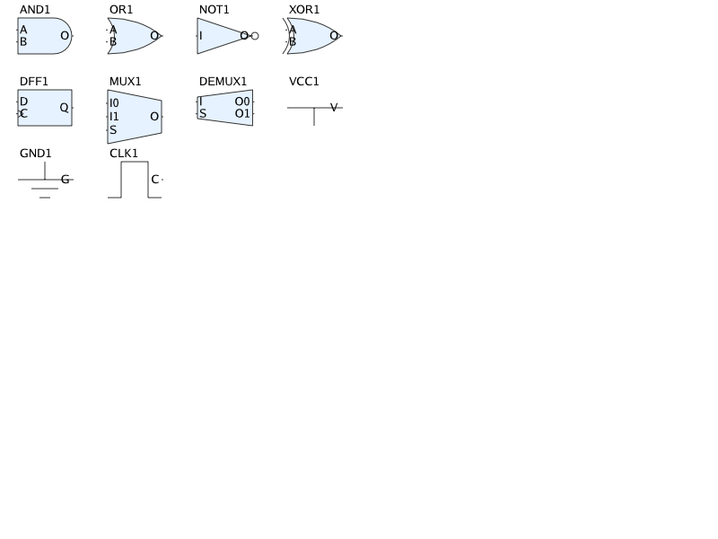
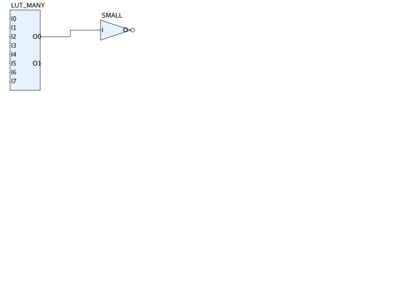
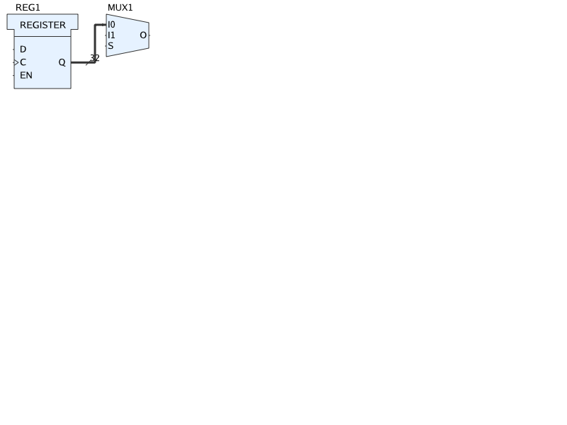

# Hodos Datasheet: Implemented Features

This document provides a hierarchical overview of the features implemented in the Hodos DSL and rendering engine.

## 1. Core Language (DSL)
*   **AST Structure**: Support for `Diagram`, `Block`, `Wire`, and `Layout` definitions.
*   **Lexer/Parser**: Recursive descent parser capable of reading `.hodos` files.
    *   Block Attributes: `kind`, `inputs`, `outputs`, `params`, `size`.
    *   Wire Attributes: `source`, `destination`, `thickness`, `crossline`, `hint`.
    *   Layout Attributes: Explicit coordinate mapping (`at (x,y)`).

## 2. Rendering Engine
*   **Base Graphics**: Integration with `draw2d` for vector rendering.
*   **Aesthetics**: Default Xilinx UG474 styling (Light Blue blocks, Dark Grey outlines).
*   **Shapes Library**:
    *   Basic Logic: `AND`, `OR`, `NOT` (IEEE standard geometry).
    *   Sequential: `DFF` (D-Flip-Flop with clock tick).
    *   Routing: `MUX` (Trapezoidal multiplexer).
    *   Fallback: Standard rectangular block rendering.
*   **Wire Routing**:
    *   Support for `thickness` styling.
    *   Orthogonal routing paths (`straight`, `L-shape`, `Z-shape`).
    *   Bus width indicators (`crossline`).

## 3. Layout Engine
*   **Auto-Layout**: Basic flow-based coordinate assignment for unmapped blocks.

## 4. Tooling
*   **CLI Application**: `hodos` binary.
    *   `hodos compile <file>`: Validates DSL syntax.
    *   `hodos render <file> [-format png] [-o output]`: Generates diagram images.

## 5. Continuous Delivery
*   **Automated Releases**: GitHub Workflow for multi-arch binary releases (Linux, macOS).
*   **Versioning**: Automatic semantic version tagging.

## 6. IEEE Standard Shape Library
Hodos provides a comprehensive library of digital logic blocks based on IEEE standards.

### 6.1 Supported Shapes
*   **Logic Gates**: `AND`, `OR`, `NOT`, `XOR`.
*   **Sequential Logic**: `DFF`, `JKFF`, `TFF`, `SRFF`.
*   **Routing**: `MUX`, `DEMUX`.
*   **Power/Signal**: `VCC`, `GND`, `CLOCK`.

### 6.2 Visual Reference

## 7. AST Validation
Hodos includes a validation layer to ensure logical correctness before rendering.
*   **Unique Names**: Blocks must have unique identifiers.
*   **Connectivity**: Wire source and destination blocks must exist.
*   **Pin Verification**: Referenced pins must exist on their respective blocks.

## 9. Dynamic Gate Sizing
Hodos automatically calculates block dimensions based on the number of input and output pins.
*   **Automatic Height**: Blocks expand vertically to accommodate multiple pins while maintaining even distribution.
*   **Precise Pin Positioning**: Pins are positioned exactly at the boundary intersection, ensuring clean orthogonal routing.

### 9.1 Visual Reference

## 8. Pins and Buses
Hodos supports explicit pin rendering and multi-bit bus visualization.
*   **Pin Rendering**: Named inputs and outputs are rendered on block boundaries.
*   **Bus Thickness**: Wires can have custom thickness to represent buses.
*   **Crossline Indicator**: Standard bus width indicators with labels.

### 8.1 Visual Reference

